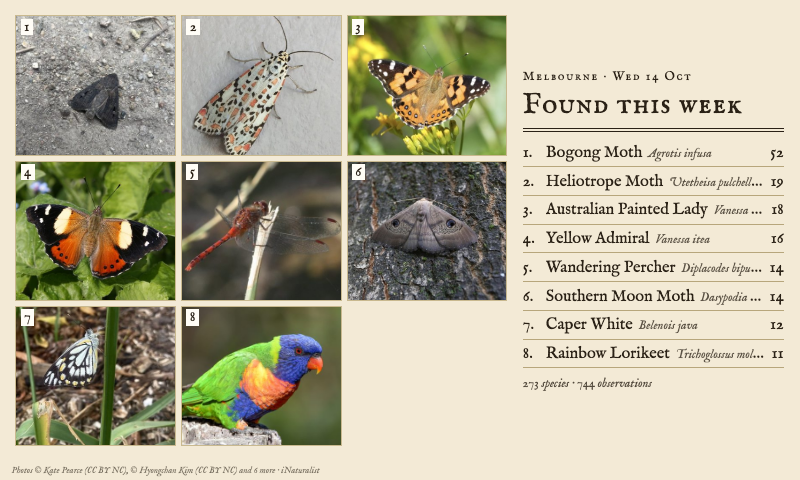
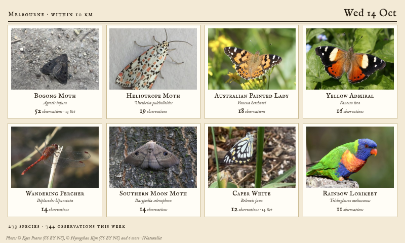
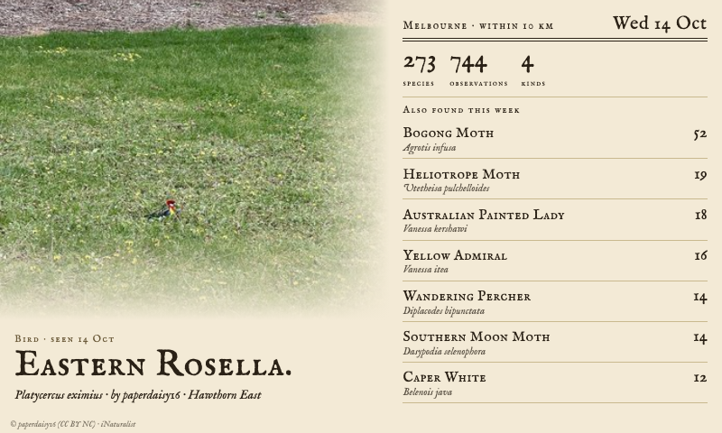
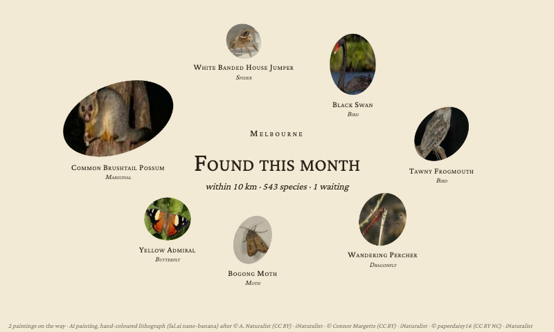

# Nature Nearby (iNaturalist)

A [Tesserae](https://github.com/dmellok/tesserae) widget showing what people have found near a place lately on [iNaturalist](https://www.inaturalist.org), or one person's own observations: birds, mammals, reptiles, insects, spiders, plants, fungi and more, as broad or as fine as you like.

iNaturalist's public API needs no account. The widget makes two requests per refresh (the species found, and the newest observations) and keeps the answer for the interval you choose, well inside iNaturalist's guidance of one request a second and ten thousand a day.

## Where and whose

**Place** is the cell's location (or the app's), with **Within** setting the circle round it, 2 to 50 km. **Only this iNaturalist user** narrows everything to one person's observations: put your own username there to see what you have catalogued, near the place or, with no place set, anywhere in the world.

**What to show** is a list of kinds you tick, from the broad (Birds, Mammals, Insects, Plants, Fungi) to the fine (Butterflies, Dragonflies, Orchids, Ferns, Lichens, Marsupials, Bats, Frogs, Sharks and rays). They add up: Insects and Orchids together shows both. Nothing ticked shows everything. **Looking back** is a week to a year; **Observations** takes research-grade ones (the community agrees on the species) or anything with a species name.

## Layouts

| Layout | What it shows |
| --- | --- |
| Cluster | The most observed species on one page. With AI paintings, each is cut out of its painting and the cut-outs are packed together as a specimen sheet, a numbered plate with a key, a wreath round a title, a field notebook with taped-in pictures or a specimen drawer; with photos, a numbered montage with a key |
| Gallery | A card per species: the observer's photo, name, scientific name, how many observations and when it was last seen |
| Latest find | The newest observation's photo to the edge of the page, with species, observations and kinds counted beside it and the rest listed |
| Field log | The newest observations as a list, each with its kind, scientific name, observer and how long ago, beside the newest one's picture |
| Full bleed | The newest find's picture fills the cell, with a name band |
| Tally | A ledger of the kinds found, with species and observations in each, and the most observed species beside it |

Every layout adapts to portrait cells. The pages are printed matter, cream paper and engraved type (IM Fell English), with Playfair, typewriter, handwritten and modern faces to choose from, and a **Panel** option that converts the pictures for greyscale and black-and-white panels.

## Pictures

**The observers' photos** are the observation's own photo (the newest one of each species), or the species' photo on iNaturalist when none came through. Only photos under a Creative Commons licence are fetched, and each is credited to its photographer at the foot of the page.

**AI paintings** paint each species once, in the style you choose, from the observation's own openly licensed photo (so the painting is of the very animal or plant somebody found), through [fal.ai](https://fal.ai)'s nano-banana model at about US$0.04 a species. It needs a fal.ai key in the widget's settings, and a daily limit there keeps a busy place from painting the whole field guide at once. Painting takes longer than Tesserae gives a fetch, so it runs in the background, one new painting per refresh: the species shows its photo until the painting lands. Once a painting lands the widget also asks fal.ai's BiRefNet model for the same picture with its paper removed, so the cluster page cuts on the subject's true outline.

The 46 styles are the Backyard Birds widget's, word for word with the bird taken out: natural history plates and prints (Gould, Audubon, woodblock, engraving, linocut, field sketch, risograph, screen print, Charley Harper), the decorative styles round Art Nouveau (Mucha, Jugendstil, Glasgow, Vienna Secession, Art Deco, Morris, Japonisme, Rackham, Beardsley, Tiffany glass), period and ornament (chinoiserie, Persian miniature, bestiary, Byzantine icon, folk art, Delft, cigarette card), fine art, crafts (origami, paper cut, embroidery, felt, clay, bricks, stained glass, mosaic), playful looks and a few jokes, plus **Your own prompt**. The prompt knows what kind of thing it is painting: a bird perches on a branch, a mammal stands in profile, a fungus sits on its patch of ground as in a mycological plate, an insect is spread as in an entomological plate, a plant is a single stem as in a botanical plate.

The widget's page under **Widgets** lists every painting with its credit, paints a species on demand or a whole style at once, keeps earlier versions when a species is repainted, and shows a live ticker of what fal.ai is painting now.

## Cluster options

**Look** picks the page; **Arrangement** where the specimens go (the look's own, an oval, a circle, a ring, rows, a scatter, a heap at the foot); **Sizes** how big each is drawn: by kind (a mammal large, an insect small, a plant in between), the most or the least observed biggest, or all alike. **Text** is the whole key, the labels under each specimen alone, or nothing, with **Label lines** choosing name, scientific name, kind, observations, when it was last seen and who saw it, at a **Text size** of your choice.

## Files

Under the widget's data folder: `result_<slug>.json` (iNaturalist's answers, kept for the refresh interval), `img/` (fetched photos and resized copies), `gen/` (AI paintings, their cut-outs and credits, the daily budget, the last failure per species and the built cluster pages) and `gen/archive/` (earlier paintings).

## Licence

AGPL-3.0. The bundled fonts carry their own licences in `fonts/`. Photos belong to their observers under the licence each chose on iNaturalist; the credit line names them.
